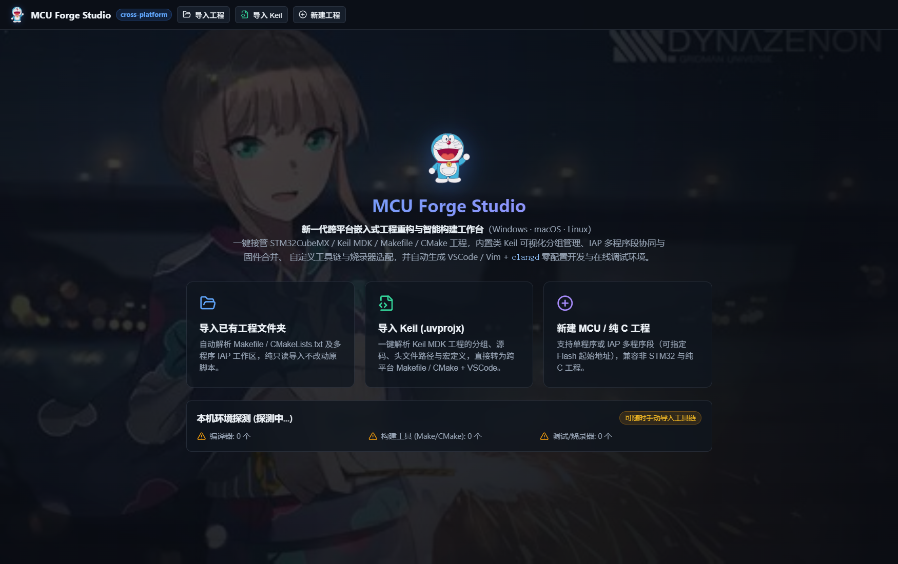
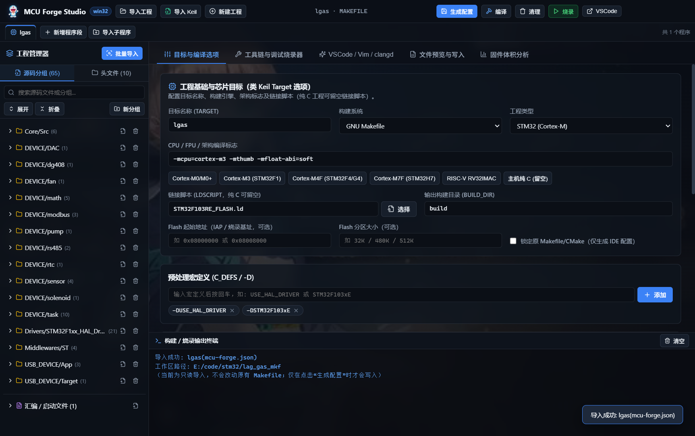
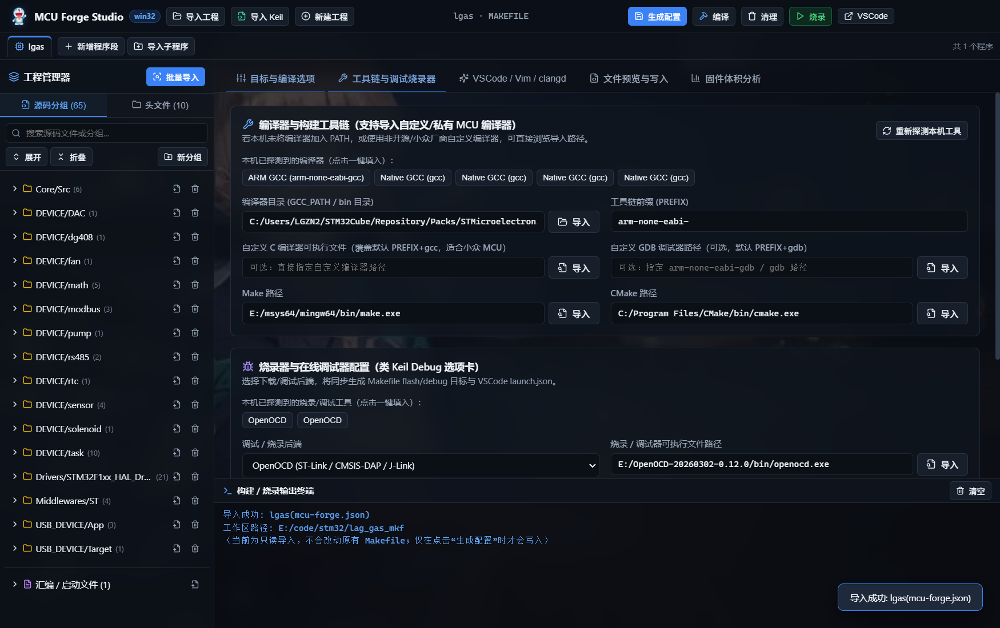

<p align="center">
  
</p>

<h1 align="center">MCU Forge Studio</h1>

<p align="center">
  <strong>新一代跨平台嵌入式工程重构与智能构建工作台（Windows · macOS · Linux）</strong>
</p>

<p align="center">
  一键接管 STM32CubeMX / Keil MDK / Makefile / CMake 工程 · IAP 多程序段协同与固件合并 · 自定义工具链/烧录器导入 · 自动生成 VSCode / Vim + <code>clangd</code> 零配置开发与在线调试环境
</p>

---

## 为什么做 MCU Forge Studio？

许多嵌入式工程师希望摆脱传统闭源 IDE（如 Keil MDK）在代码补全、跨平台协作和编辑体验上的束缚，转向 **VSCode / Vim + GCC / CMake / Makefile + OpenOCD** 现代工作流，但在实际迁移中常常面临以下痛点：

- **手动维护 `Makefile` / `CMakeLists.txt` 繁琐**：每新增一个驱动模块或头文件目录都要手动复制粘贴路径，极易遗漏。
- **`clangd` 与 VSCode 调试配置门槛高**：`compile_commands.json`、`.clangd`、`--query-driver`、`cortex-debug` 的 `launch.json` 稍有配错就会满屏假红线或无法 F5 调试。
- **跨平台与自定义工具链难兼容**：Windows / macOS / Linux 路径与 Shell 规则不同，小众/私有 MCU 编译器往往不在系统 `PATH` 中。
- **IAP 多程序工程难统一管理**：一个项目目录里同时包含 `Bootloader` 与 `App` 时，缺少统一的界面切换、Flash 起始地址校验与固件合并工具。

**MCU Forge Studio** 将 Keil 的直观工程管理体验与现代开源工具链完美结合，提供开箱即用的桌面端可视化工作台。

---

## 核心特性

- **多源一键导入（纯只读不破坏原工程）**
  - 自动解析 STM32CubeMX / 手写 `Makefile`、`CMakeLists.txt` 与原始源码目录；默认只读导入，仅在用户显式点击「生成配置」时才写入磁盘，并支持「锁定原 Makefile（仅生成 IDE 配置）」与 `.bak` 自动备份。
  - 支持直接导入 **Keil MDK `.uvprojx`** 工程，自动还原源码分组、头文件路径、宏定义、芯片型号、Flash 地址及 GCC 启动文件。
- **类 Keil 可视化工程管理器**
  - 顶部双标签页独立切换 **源码分组** 与 **头文件路径**，默认全部折叠，内置一键展开/折叠与实时模糊搜索。
  - 支持递归目录批量扫描导入 `.c/.cpp/.s` 与 `.h/.hpp`、单文件级 **禁用编译（Exclude from Build）**、以及第三方静态库 `.a` / `-L` 路径管理。
- **IAP 多程序段与纯 C 工程新建**
  - 顶部多程序标签栏以 `Makefile` 的 `TARGET` 名命名并显示 Flash 起始地址徽章，自动发现工作区子目录中的多个独立程序。
  - 内置 **Flash 地址重叠自动检测**、**彩色 Flash 内存分布条**、**一键全部编译** 以及 **Boot + App 固件自动合并（`.bin` / `.hex`）**。
  - 新建向导支持 STM32、通用 ARM、RISC-V、自定义小众 MCU 以及主机端纯 C/C++ 工程（所有硬件/调试控件均可留空后续补全）。
- **跨平台工具链与自定义导入**
  - 自动探测本机 ARM GCC、RISC-V GCC、Native GCC/Clang、Make、CMake、Ninja、OpenOCD、J-Link、ST-Link、PyOCD、clangd 与 VSCode。
  - 支持手动导入任意小众/私有编译器与自定义烧录命令；支持开启 **`local.mk` 三端路径解耦**（Win/Mac/Linux 共享同一份 Git 仓库零冲突）与 **Pre-build / Post-build** 自定义钩子。
- **VSCode / Vim + `clangd` 无缝衔接**
  - 一键生成 `compile_commands.json`、`.clangd`、`.vscode/{tasks,launch,settings,extensions}.json` 与 `flash.jlink`。
  - 终端按行区分错误（红）/ 警告（黄）/ 提示（蓝），实时统计 `Errors / Warnings` 数量，**点击报错文件路径直接跳转到 VSCode 对应行号**，并提供 **Flash / RAM 符号占用 Top 排行分析**。

---

## 界面展示与功能讲解

### 1. 启动欢迎页与本机环境自动探测
提供 **导入已有工程文件夹**、**导入 Keil `.uvprojx`** 与 **新建 MCU / 纯 C 工程** 三大入口，自动探测本机已安装的编译器、构建工具与调试烧录器，并记录最近打开的工程。



### 2. 主工作台：多程序标签 + 类 Keil 工程树 + 目标配置
- **顶部多程序标签栏**：支持 IAP 多程序段切换、`+ 新增程序段`、`导入子程序`、多程序 Flash 内存分布条、全部编译与固件合并。
- **左侧工程管理器**：源码分组与头文件双标签切换，默认折叠并支持实时搜索、批量扫描导入与单文件禁用编译。
- **右侧目标与编译选项**：可视化配置架构预设、链接脚本、Flash 起始地址、宏定义、静态库 `.a`、Pre/Post-build 钩子及 `local.mk` 三端解耦。
- **底部实时终端**：按颜色区分 Error（红）/ Warning（黄）/ Note（蓝），点击报错位置直达 VSCode 对应代码行。



### 3. 工具链与调试烧录器面板
自动列出本机探测到的编译器与调试器（点击一键填入），也支持手动浏览导入小众 MCU 的自定义编译器、GDB、OpenOCD、J-Link、ST-Link、PyOCD、SVD 寄存器文件或自定义烧录命令。



### 4. 生成文件实时预览与安全写入
写入磁盘前可逐一审查即将生成的 `Makefile` / `CMakeLists.txt`、`compile_commands.json`、`.clangd`、`.vscode/*` 与 `flash.jlink`，默认开启 `.bak` 首次备份，安全可控。


---

## 一键安装包下载（Windows / macOS / Linux）

无需安装 Node.js 或 npm，直接前往本仓库的 **[Releases](https://github.com/fangyubao/mcu-generate-/releases)** 页面下载对应平台的一键安装包：

- **Windows**：`MCU Forge Studio-x.x.x-win-x64.exe`（安装版 / 便携版）
- **macOS**：`MCU Forge Studio-x.x.x-mac-arm64.dmg` / `x64.dmg`
- **Linux**：`MCU Forge Studio-x.x.x-linux-x64.AppImage` / `.deb`

---

## 从源码构建（开发者）

```bash
git clone https://github.com/fangyubao/mcu-generate-.git
cd mcu-generate-
npm install

# 本地启动
npm start

# 开发热重载
npm run dev

# 分别打包三端可执行安装包
npm run pack:win    # Windows (.exe NSIS + Portable)
npm run pack:mac    # macOS (.dmg + .zip)
npm run pack:linux  # Linux (.AppImage + .deb)
```
